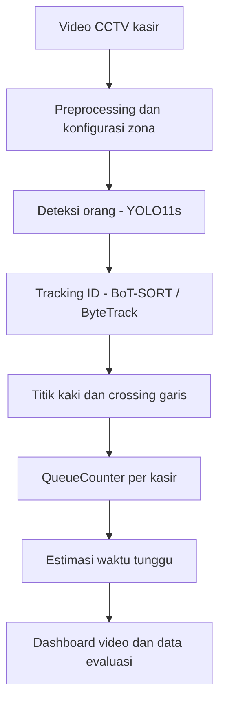

# QueueWise - Monitoring Antrean & Estimasi Waktu Tunggu

> Proyek Computer Vision untuk memantau antrean dari video CCTV dan memperkirakan waktu tunggu pelanggan pada **Kasir Tengah** dan **Kasir Kanan**.

**Status:** prototipe akademik / proof of concept. Kode utama berasal dari notebook proyek; pengujian logika disediakan, tetapi akurasi pada video nyata harus divalidasi dengan *ground truth* manual. Jangan menganggap estimasi sebagai jaminan waktu pelayanan.

## Gambaran proyek

QueueWise membaca video dari kamera tetap, mendeteksi orang dengan **YOLO11s**, melacak identitas dengan **BoT-SORT** (dengan fallback ByteTrack jika perlu), lalu menggunakan posisi titik kaki dan garis virtual untuk menentukan pelanggan yang masuk, menunggu, mulai dilayani, keluar, atau hilang dari pelacakan. Setiap kasir mempunyai penghitung antrean sendiri.

**Hasil utama:** perkiraan waktu **sampai mulai dilayani** dan **sampai selesai dilayani** bagi pelanggan yang **baru akan bergabung** ke antrean. Video dashboard dan CSV dipakai sebagai bahan demo serta evaluasi.



## Fitur

- Dua antrean independen: Kasir Tengah dan Kasir Kanan.
- Garis **MASUK** dan **KELUAR** dengan pemeriksaan arah serta batas ruas garis.
- Zona pelanggan (*queue ROI*) dan zona layanan (*service ROI*).
- Status **OUT**, **QUEUE**, **SERVING**, **DONE**, **LOST**.
- Penanganan pelanggan awal (`INITIAL`), registrasi pemulihan (`ENTRY_RECOVERED`), dan perubahan ID (`ID_MERGED`).
- Estimasi waktu berbasis sampel layanan; jika belum cukup, memakai asumsi awal yang **bukan hasil pengukuran**.
- Ekspor video, `event_log.csv`, `timeline.csv`, data pelanggan, ringkasan kasir, grafik, dan konfigurasi run.
- **68 skenario tes logika** (34 per kasir) yang tidak membutuhkan video maupun GPU.

## Struktur repository

```text
Class_Group05_OpenCV_Final_Submission/
├── README.md                         # Dokumentasi GitHub
├── .gitignore                        # Abaikan video, model, cache, output besar
├── CHECKLIST_SEBELUM_SUBMIT.md        # Item yang masih perlu dilengkapi
├── github_commands.txt               # Contoh perintah push ke GitHub
├── youtube_link.txt                  # TEMPAT link demo YouTube (belum diisi)
├── Source_Code/
│   ├── QueueWise_kasir_exit_fixed.ipynb  # Source code utama (asli)
│   ├── main.py                        # Runner CLI dari notebook yang sama
│   ├── requirements.txt              # Dependensi runtime
│   ├── requirements-test.txt         # Dependensi tes tanpa YOLO
│   ├── README.md                     # Panduan menjalankan dan troubleshooting
│   └── tests/test_logic.py           # Menjalankan 68 tes dari notebook
├── Dataset_or_Sample_Input/
│   └── README.md                     # Petunjuk video sumber dan hak pakai
├── Appendix/
│   ├── Team_Contributions.md         # Template kontribusi tim
│   └── Team_Contributions_TEMPLATE.pdf
└── .github/workflows/logic-tests.yml # CI tes logika (tanpa video/GPU)
```

**Catatan:** berkas laporan PDF, slide PDF, link demo YouTube, dan identitas/kontribusi anggota **belum final** di paket ini. Lihat [checklist](CHECKLIST_SEBELUM_SUBMIT.md) sebelum mengumpulkan ZIP sesuai format dosen.

## Menjalankan di Google Colab (direkomendasikan)

1. Buka [`Source_Code/QueueWise_kasir_exit_fixed.ipynb`](Source_Code/QueueWise_kasir_exit_fixed.ipynb) di Google Colab.
2. Pilih **Runtime > Change runtime type > GPU** bila tersedia (CPU tetap bisa, lebih lambat).
3. Pilih **Runtime > Restart session and run all**.
4. Saat diminta, **unggah video CCTV asli**, bukan video yang sudah berisi overlay QueueWise.
5. Periksa pratinjau garis MASUK/KELUAR, zona pelanggan, dan titik kaki. Jalankan sampai selesai.
6. Unduh paket hasil `QueueWise_hasil_demo.zip` yang dibuat oleh notebook.

Notebook memiliki `VIDEO_PATH` bawaan berupa path file lokal di Colab. Jika file itu tidak ada, notebook akan mencari video lain atau meminta unggahan. Jika ada beberapa video, ubah `VIDEO_PATH` secara eksplisit agar tidak salah memilih.

## Menjalankan lewat terminal / lokal

Gunakan Python dengan dukungan PyTorch. Di root repository:

```bash
python -m pip install -r Source_Code/requirements.txt
python Source_Code/main.py --video "path/ke/video_kasir_asli.mp4" --max-frames 300
```

Untuk memproses seluruh video:

```bash
python Source_Code/main.py --video "path/ke/video_kasir_asli.mp4"
```

Untuk memilih folder keluaran dan melewati preview deteksi:

```bash
python Source_Code/main.py --video "path/ke/video_kasir_asli.mp4" --output hasil_queuewise --skip-detection-preview
```

`main.py` adalah **runner** yang mengeksekusi sel kode dari notebook utama (bukan implementasi algoritma kedua). Dengan demikian, perubahan pada logika di notebook tetap menjadi sumber utama. Penggunaan CLI belum diuji end-to-end dengan video asli pada lingkungan pembuatan paket ini; lakukan uji lokal/Colab sebelum presentasi.

## Tes logika tanpa video

```bash
python -m pip install -r Source_Code/requirements-test.txt
python -m pytest -q Source_Code/tests/test_logic.py
```

Tes ini memeriksa 68 skenario sintetis. **Lulus tes tidak berarti akurasi video 100%.** Untuk hasil counting/estimasi video nyata, diperlukan anotasi manual (*ground truth*) dan pasangan waktu masuk-keluar yang valid.

## Konfigurasi utama

| Konfigurasi | Nilai pada notebook | Keterangan |
|---|---|---|
| Model | `yolo11s.pt` | Bobot COCO pretrained; diunduh saat pertama kali dipakai |
| Deteksi | `classes=[0]`, `conf=0.15`, `iou=0.50`, `imgsz=960` | Hanya kelas orang |
| Tracker | BoT-SORT + ReID, fallback ByteTrack | Tracker aktif dicatat dalam `run_config.json` |
| Referensi koordinat | `640 × 360` | Garis dan zona diskalakan ke resolusi video |
| Lost timeout | `15 detik` | Hilang dari pelacakan |
| Di luar ROI | `3 detik` | Dapat dianggap LOST sesuai aturan |
| Asumsi awal durasi layanan | `(25, 45, 90)` detik/orang | **Asumsi**, bukan pengukuran empiris |
| Jendela ringkasan | `30 detik` | Ringkasan per interval waktu video |

## Keluaran

Hasil pemrosesan tersimpan di folder `outputs_queuewise/` (atau folder `--output`):

- `queuewise_output.mp4`: video dashboard utama.
- `queuewise_demo_h264.mp4`: versi H.264 jika FFmpeg tersedia.
- `event_log.csv`: peristiwa ENTRY, EXIT, INITIAL, LOST, dll.
- `timeline.csv`: kondisi setiap kasir per frame.
- `pelanggan.csv`: ringkasan per pelanggan.
- `ringkasan_kasir.csv`: kondisi dan estimasi pada akhir video.
- `ringkasan_per_jendela_waktu.csv`: ringkasan interval 30 detik.
- `track_log.csv`: jejak ID dan titik kaki (jika diaktifkan).
- `unit_tests.csv`, `run_config.json`, `screenshots/`: tes, konfigurasi, dan gambar evaluasi.

## Dataset / video sumber

Demo dirancang untuk video CCTV kasir dengan sudut kamera tetap, judul yang disebut di notebook: **HD-SDI 1080P Hi Definition Megapixel Security Camera Super Market Checkout Sample #1**. Salinan video dan tautan sumber aslinya **tidak disertakan**. Baca [`Dataset_or_Sample_Input/README.md`](Dataset_or_Sample_Input/README.md) untuk cara menyiapkan input dan informasi atribusi yang perlu dilengkapi. Jangan mengunggah ulang video pihak ketiga tanpa izin/lisensi yang sesuai.

## Batasan

- Koordinat zona disetel untuk **sudut kamera video contoh**. Sudut kamera berbeda perlu kalibrasi ulang.
- Objek yang saling menutupi dapat mengganggu deteksi dan konsistensi ID.
- `SERVING` diperkirakan dari posisi pelanggan, bukan deteksi transaksi kasir secara langsung.
- `INITIAL` dan `ENTRY_RECOVERED` bukan bukti crossing masuk yang teramati.
- Waktu tunggu adalah **estimasi yang dapat berubah**, bukan kepastian pelayanan.
- Akurasi counting dan MAE tidak boleh diklaim sebelum hasil video akhir dan *ground truth* diperiksa.

## Tim, laporan, dan video demo

- **Kelompok:** 05 (mengikuti nama file laporan yang tersedia; sesuaikan bila berbeda).
- **Anggota:** isi nama dan NIM pada [`Appendix/Team_Contributions.md`](Appendix/Team_Contributions.md).
- **Laporan dan slide PDF:** tambahkan versi final sesuai nama pada [checklist](CHECKLIST_SEBELUM_SUBMIT.md).
- **Video demo:** ganti placeholder pada [`youtube_link.txt`](youtube_link.txt).

## Referensi teknis

- [Dokumentasi YOLO11 - Ultralytics](https://docs.ultralytics.com/models/yolo11/)
- [Dokumentasi Object Tracking - Ultralytics](https://docs.ultralytics.com/modes/track/)
- [Dokumentasi OpenCV](https://docs.opencv.org/)

> Repository ini adalah dokumentasi prototipe akademik. Evaluasi akhir perlu menggunakan hasil run yang benar-benar diverifikasi.
